# 设计报告：智能体驱动可配置视觉处理系统（Zynq-7020）

> Agent-Driven Configurable Vision Processing System on Zynq-7020
> 本报告按竞赛要求组织为七部分：选题背景与创新点 / 设计原理与功能框图 / 软硬件划分依据与
> 接口设计 / 优化过程（含前后对比表）/ 大模型协作记录 / 技能包提炼过程 / 复现说明。
> 图表取自《技术文档》与工程实测记录，仅收录关键项；完整版技术文档与逐条协作记录见
> `report/llm_collaboration_log.md` 与工程内文档。

## 1. 选题背景与创新点

### 1.1 要解决的实际问题

嵌入式视觉产品的真实痛点不在"能不能识别"，而在**迭代成本**：换一个检测对象、上线一个新
应用，传统路线要经历"改固件 → 重编译 → 重烧写 → 重启"，一次功能上线就是一次固件迭代。
产线换产需更换检测模型、安防场景需远程升级应用时，这种迭代方式既慢又危险（停机、变砖风险）。

本作品把这个问题收敛为：**功能上线 = 一次文件传输**。固件退化为与模型无关的通用平台，
模型与应用都是 SD 卡上可替换的文件，经网口推送落卡、免重启生效。

### 1.2 前人工作与本作品定位

| 路线 | 代表工作 | 特点与局限 |
|---|---|---|
| 纯软件推理 | PYNQ 类平台（文献[3]） | 灵活但推理速率受限，同代器件约 3 img/s |
| 专用硬件加速 | 文献[2]：Zynq-7020 上 CNN 船舶识别加速器 | 84.65% LUT 实现 6.15 fps，但**换网络须重新设计电路** |
| **本作品：PS＋PL 协同** | — | 视频通路全硬件、推理留软件，17.68% LUT 承载视频平台＋推理运行时 |

与硬件加速路线相比，我们主动放弃单模型峰值帧率，换取"换模型零固件改动"的平台能力；
与纯软件路线相比，视频搬运下沉硬件后，处理器算力完整留给推理与业务。

### 1.3 主要创新点

1. **智能体驱动的交付闭环**：上位机智能体自动调度"训练 → 导出 ncnn → 量化审阅 → 封包 →
   交叉编译 → TFTP 推板"全流程，板上模型与应用热更新，迭代零固件改动；
2. **模型即文件**：预处理、解码、结果过滤等随模型而异的知识全部封装于 SD 卡模型包
   （四文件：结构/权重/标签/模型模块），拷贝即换网络；
3. **应用即插件**：应用独立编译为二进制，经 64 字节头部与三方版本校验后零重定位装载，
   推送落卡桌面自动上架；
4. **全硬件视频主干**：采集、三帧循环缓冲与 LCD/HDMI 双路显示全由 PL 电路承担，像素流
   不经处理器，DSP 资源占用为 0。

## 2. 设计原理与功能框图

### 2.1 系统总体架构

系统由 PC 端上位机（含智能体）与 Zynq-7020 板端组成。Zynq 单芯片集成双核 ARM Cortex-A9
（PS）与可编程逻辑（PL）：PS 运行 FreeRTOS、ncnn 推理与 LVGL 桌面；PL 配置为专职视频采集
与显示电路。两域经片内 AXI 互连、共享 DDR 协作——"PL 运图像，PS 算结果"。

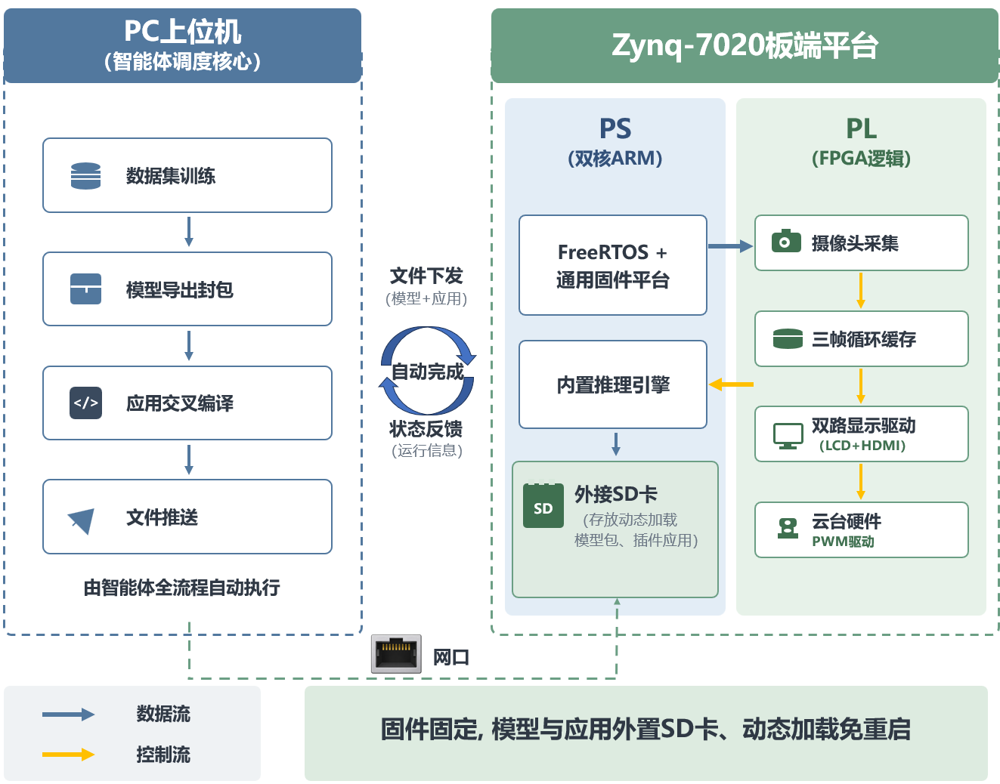

工作原理一句话：摄像头像素流由 PL 电路还原、打包、DMA 写入 DDR 三帧环，显示电路按各自
时序持续读出驱动 LCD 与 HDMI；PS 侧固件从帧环取单帧快照送 ncnn 推理，结果写回显存叠加
显示；模型与应用由上位机智能体调度生产，经 TFTP 写入 SD 卡，板端扫描装载、免重启生效。

### 2.2 板端软件架构

固件按**驱动层 → 实现层 → 应用层**三层单向依赖组织，运行于 FreeRTOS 五任务
（业务/界面/视频窗/网络/看门狗），任务间经命令总线与数据桥解耦。实现层不接触硬件，
除一个板卡适配文件外全部可在 PC 上编译验证。

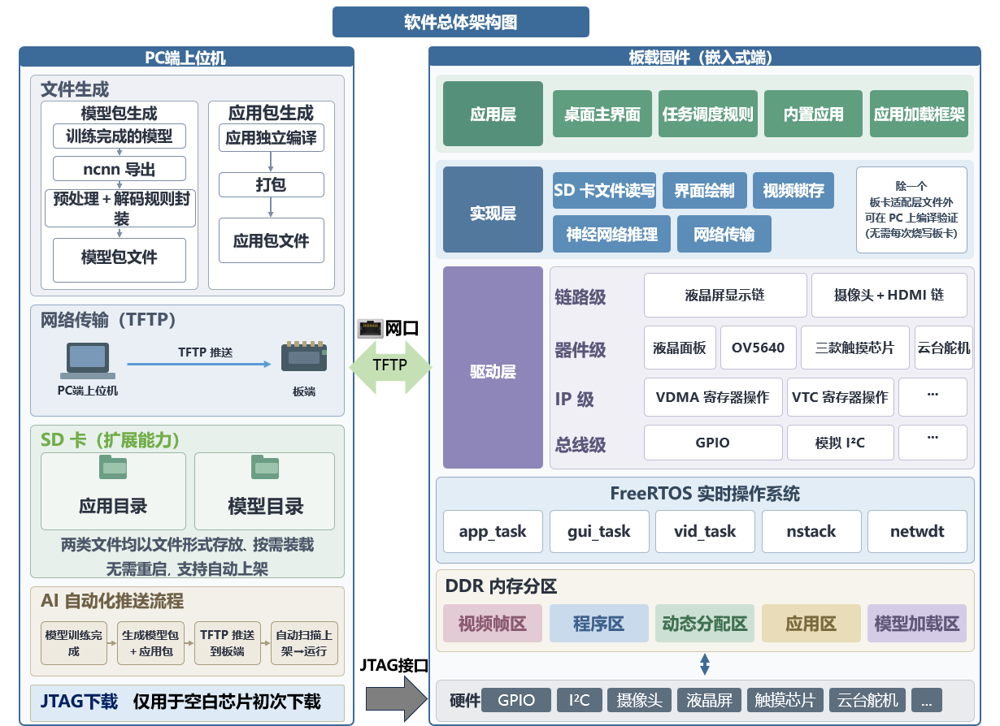

### 2.3 推理平台：通用与专用分离

ncnn 前向计算对所有模型一致，由固件承担；随模型而异的预处理、解码、NMS 封装于模型包内
的模型模块（model.mod），两者以带版本号的接口契约协作——契约变更即升版本，旧模型包自动
拒绝装载。接入新网络因此无须修改固件。

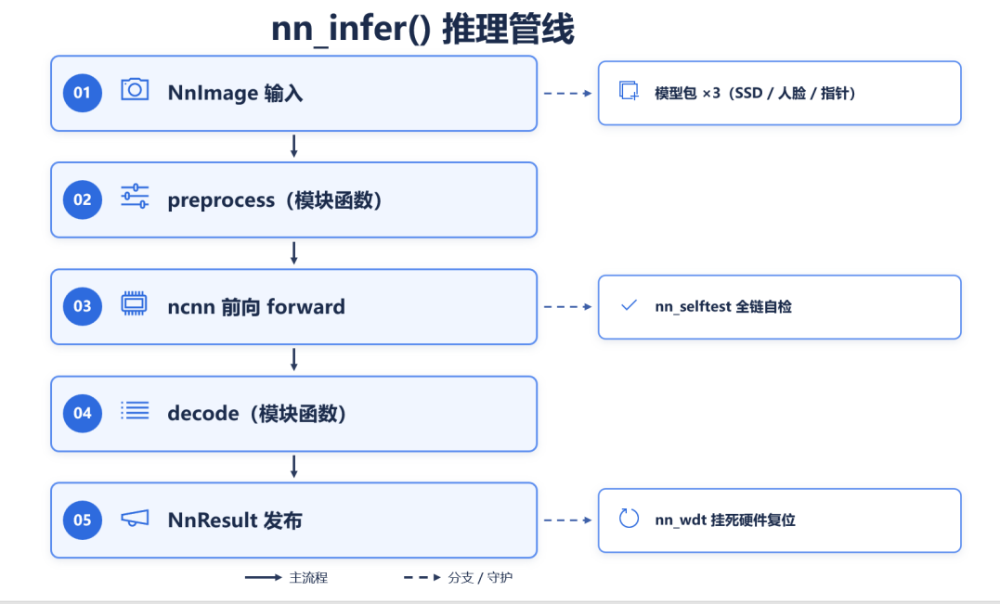

### 2.4 应用动态装载

应用独立编译为二进制存放 SD 卡 `/apps`，固件在固定地址导出服务表（符号表），应用编译时
按该表定址、装载后零重定位直接执行；固件、应用头、符号表三方版本一致方可装载。

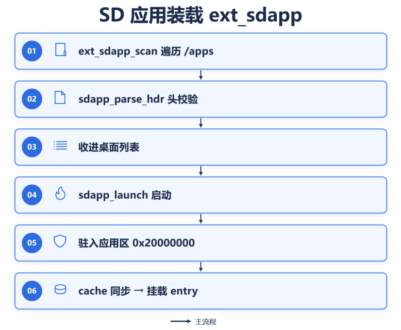

### 2.5 上位机与智能体

智能体是上位机中的调度层：使用者对话提出需求，智能体选择并调用本机既有程序完成训练、
导出、封包、PC 侧模拟、交叉编译与推送；程序输出决定下一步。密钥留空时各页面仍可手动
完成同一链路。

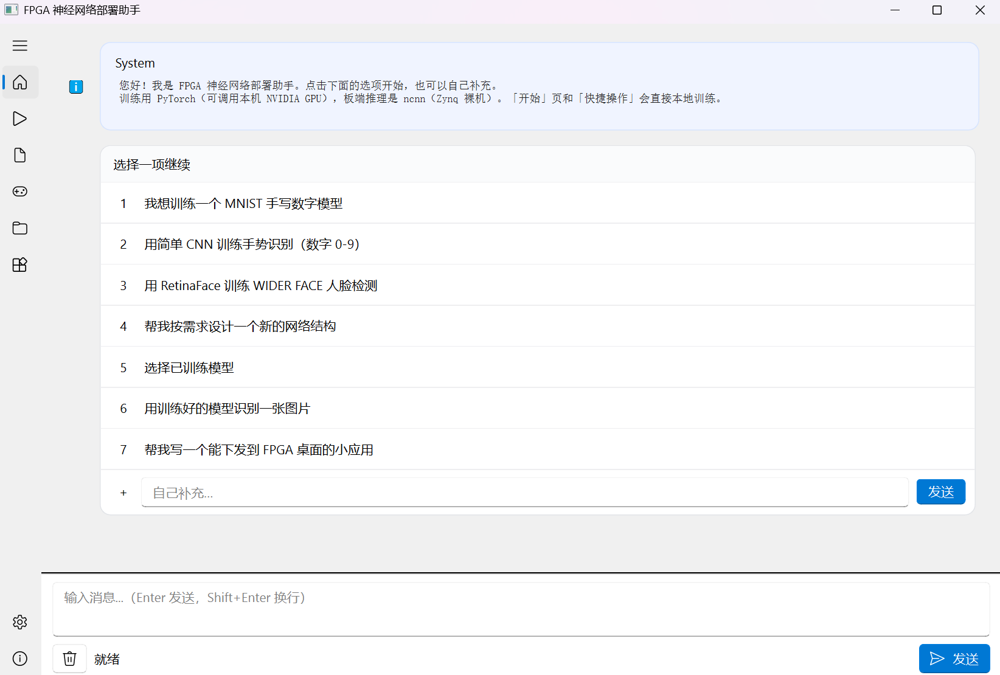

## 3. 软硬件划分依据与接口设计

### 3.1 划分依据

划分原则：**负载固定、持续吞吐的任务下沉硬件；结构多变、需要迭代的逻辑留在软件。**

- 视频采集/搬运/显示：像素流格式固定、带宽需求恒定（三路 DDR 访问合计约 408 MB/s），
  最适合电路承担，且彻底释放处理器；
- 推理：检测与分类网络结构差异大，硬件化单一网络与"换模型不改固件"目标冲突 → 留 PS；
- 云台 PWM：波形恒定（50 Hz、脉宽编码角度），由 PS 定时器硬件自持产生、经 EMIO 引出，
  不占处理器也不占 PL 逻辑。

### 3.2 四类接口

| 接口 | 路径 | 承载内容 |
|---|---|---|
| 控制通路 | PS `S_AXI_GP0` → `axi_smc` → 各 IP 寄存器 | 启停视频链、改显示时序、调像素时钟 |
| 数据通路 | VDMA 读写 → `axi_mem_intercon` → `S_AXI_HP0`（64 位）→ DDR | 像素流帧缓冲，直达内存 |
| EMIO | PS 引脚/定时器信号经 PL 封装引脚引出 | SCCB 模拟 I²C、触摸 I²C、云台双路 PWM |
| MIO | PS 专属引脚 | SD 卡（SDIO）、千兆网口（RGMII，RTL8211 PHY） |

### 3.3 PL 侧设计与 BD 图

Vivado Block Design 共 17 个 IP，其中 3 个自定义/定制 IP（`ip_repo/` 随仓库提供）：
`ov5640_capture_data`（DVP 还原）、`DVI_Transmitter`（TMDS 发送）、`rgb2lcd`（RGB888 输出）。
两条视频通路：采集→HDMI 链与 LCD 显示链，双通道 VDMA 汇聚于 64 位高性能端口。

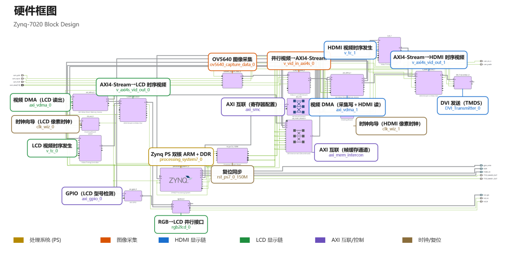

### 3.4 时钟设计

以 PS 输出 `FCLK0` 150 MHz 为基础：PL 总线、VDMA 与互连同处该域；`clk_wiz_0` 输出 LCD
像素时钟（默认 33.333 MHz，运行期寄存器动态改频适配四种屏型）；`clk_wiz_1` 输出 HDMI
75 MHz 像素钟与 5 倍 375 MHz 串化钟。

### 3.5 处理器配置

双核 Cortex-A9 666.67 MHz，运行 FreeRTOS；TTC0 定时器产生云台双路 50 Hz PWM（脉宽
500–2500 µs 对应 0°–180°，软件限幅 30°–150°）；SCCU/GEM 以太网控制器经 RGMII 接 PHY。

### 3.6 存储映射（AXI 外设与 DDR 布局）

| AXI 外设 | 基地址 | 用途 |
|---|---|---|
| axi_gpio_0 | 0x4120_0000 | 屏型 ID / 背光 |
| axi_vdma_0 | 0x4300_0000 | LCD 链帧缓冲 |
| axi_vdma_1 | 0x4301_0000 | 采集/HDMI 链三帧环 |
| clk_wiz_0 | 0x43C0_0000 | LCD 像素钟动态改频 |
| v_tc_0 / v_tc_1 | 0x43C1/2_0000 | LCD / HDMI 时序发生 |

| DDR 区域 | 起始地址 | 用途 |
|---|---|---|
| 固件本体 | 0x0010_0000 | 上界受链接脚本断言约束 |
| 摄像头三帧环 | 0x0110_0000 | 3×1280×720×3 ≈ 7.9 MB |
| LCD 显存 | 0x01A0_0000 | ≤1280×800×3 |
| 动态分配堆 | 0x0200_0000 | 224 MB（推理/网络收包） |
| 推理整帧快照 | 0x1110_0000 | ≈2.8 MB |
| SD 应用加载区 | 0x2000_0000 | 16 MB |
| 模型模块区 | 0x2100_0000 | 4 MB（图像积木缓冲 0x2140_0000 起 8 MB） |

### 3.7 关键引脚分配（摘自 pin.xdc）

| 信号组 | 引脚 | 功能 |
|---|---|---|
| TMDS clk/data | J18；J20/K19/G19 | HDMI 差分（TMDS_33） |
| cam_data[7:0] 及 pclk/href/vsync | R14 等 8 脚；W14/T12/U12 | OV5640 DVP 并口 |
| lcd_rgb_tri_io[23:0] | W18 等 24 脚 | LCD RGB888 |
| EMIO SCCB / 触摸 | T10/T11；R19/P20/M19/U19 | 模拟 I²C ×2 组 |
| TTC0_WAVE0/1 | W8 / U9 | 云台双路 PWM |

完整分配见 `src/vivado_project/.../constrs_1/new/pin.xdc`。

## 4. 优化过程（含优化前后对比表）

### 4.1 网络推送链路（三层调优 + 协议重构）

| 阶段 | 措施 | 实测吞吐 | 代价 |
|---|---|---|---|
| 初版自研 FWPUT2（TCP） | — | **77 KB/s** | 私有协议栈需自维护 |
| 调优① | TCP 接收窗口 2048 → 11680（8×MSS） | ↑ | — |
| 调优② | 收包轮询 → 阻塞接收＋超时 | ↑ | — |
| 调优③ | PHY 链速强制 → 自协商 | MB/s 量级 | — |
| 重构为标准 TFTP（UDP 69） | 512 字节锁步、任意标准客户端 | 板端实测 2937 KB/s（表 1 口径） | 以吞吐上限换健壮与通用 |

重构动机是真机暴露的连接资源耗尽与阻塞挂死（私有协议重传/粘包/断线恢复全部自维护）；
退役自研协议后专用 PC 工具随之退役，任意标准 TFTP 客户端可直接对接。

### 4.2 模型接入成本（平台化重构）

| 指标 | 重构前 | 重构后 |
|---|---|---|
| 接入新网络需改固件处数 | 5 处 | **0 处** |
| 新模型交付形态 | 固件重编译烧写 | 拷贝一个四文件模型包 |
| 生效方式 | 重启 | 免重启、桌面自动上架 |

### 4.3 资源与时序（布线后实现报告）

| 指标 | 数值 | 说明 |
|---|---|---|
| LUT / FF / BRAM | 17.68% / 14.92% / 10.71% | 视频平台 + 全部逻辑 |
| DSP | **0%** | 为后续 PL 加速保留全部余量 |
| WNS / WHS | +0.683 ns / +0.050 ns | 主时钟域 150 MHz 收敛，零违例 |
| 布线 | 21562 根网络全部布通 | route_status 零错误 |
| 片上功耗 | 2.064 W | 功耗报告估算 |

### 4.4 主要性能指标（上板实测）

| 类别 | 指标 | 实测值 |
|---|---|---|
| 视频链路 | OV5640 采集 | 1280×720 @ 30 fps |
| | 双路显示 | LCD 800×480 + HDMI 1280×720@60 Hz 同步 |
| 端侧推理 | MobileNetV2-SSDLite（300×300，int8） | 239 ms/帧 ≈ 4.2 fps |
| | RetinaFace（320×320，fp32） | ≈100 ms/帧 ≈ 10 fps |
| | 检测精度 | SSDLite 86.62% / RetinaFace 84.92% |
| 控制传输 | 云台闭环 | 20 Hz，硬件 PWM |
| | TFTP 文件推送 | 2937 KB/s |

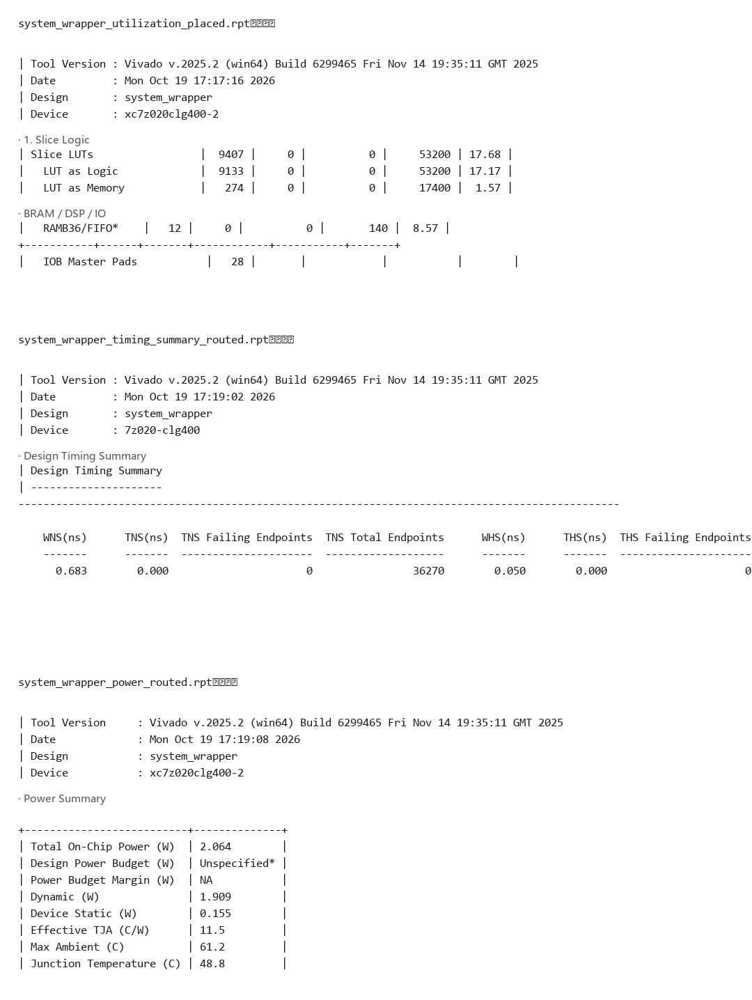

### 4.5 其余关键优化

- **相机链热待机**：放弃"全停重配"（写通道未排空即复位 → 状态机冻结，仅断电可恢复），
  改为传感器睡眠、链路受控的热待机，再启动从秒级降到百毫秒级；
- **画面撕裂消除**：三帧循环缓冲 + 读端动态 GenLock（读端永远落后写端一帧），HDMI 运行期
  启停时同步关系动态挂摘；
- **推理帧间泵送**：单帧推理数百毫秒，每完成一帧即检查命令队列，停止/切换命令帧间即响应。

## 5. 大模型协作记录

协作纪律：**引用必须可溯源、数据必须来自工程文件、模型输出的工程外名词一律回查。**
完整逐条记录（含提示词与回答要点）见 [`llm_collaboration_log.md`](llm_collaboration_log.md)。

| # | 场景 | 提示词要点 | 模型回答 → 人工核验 | 自我纠错轨迹 |
|---|---|---|---|---|
| 1 | 文献核验 | 要求逐条给出卷期页码 | 未经确认先行引用两篇文献 | 人工质疑后逐条到出版方官网核对，5 篇引用全部可溯源 |
| 2 | XDC 约束整理 | 正则提取引脚约束 | 首轮 53 项 | 抽查发现漏拆行书写的 PWM 约束 → 正则初筛+拆行扫描+端口交叉核对 = 55 项 |
| 3 | 框图识别 | 从 BD 截图识别模块名 | 小字号两次误读（DVI IP 误作采集 IP） | 先从 system.bd 提取合法名词清单，令模型在清单内受约束选择，17/17 对齐 |
| 4 | 网络协议取舍 | 分析 FWPUT2 卡死根因 | 定位连接资源耗尽 | 采纳"以成熟协议替换自研"结论 → 重构 TFTP |
| 5 | 堆写坏排查 | 堆遍历三分法 | 定位堆被写坏（未结案） | 嫌疑收敛至开机 DMA/网络收包路径，探针固化可复测，如实记录未结案 |

**智能体工作流设计**：上位机智能体不直接产出权重或二进制，只做"选择程序 → 调用 → 依据
输出决定下一步"的调度；密钥留空时同一链路可纯手动走通——AI 加速而不形成依赖。

## 6. 技能包的提炼过程

技能包（`skill/`）四类内容全部来自本工程的真实失败与观察，每项均注明来源、验证方式与
失效边界（详见 [`skill/README.md`](../skill/README.md)）：

| 技能项 | 来源（失败/观察） | 如何验证有效 | 边界 |
|---|---|---|---|
| XDC 约束审查工作流 | 拆行 PWM 约束漏提（协作记录 #2） | 对 pin.xdc 实跑，53→55 项复核 | 仅覆盖 Vivado XDC 语法子集 |
| 文献溯源工作流 | 模型幻觉引用（#1） | 5 篇逐条官网核对 | 需人工终审 |
| 框图识别防幻觉 | BD 小字误读（#3） | 名词清单约束后 17/17 对齐 | 依赖 system.bd 可解析 |
| 仓库完整性校验脚本 | ip_repo 外链缺失这一"隐藏硬伤" | 实跑抓出 ip_repo 缺失 + 11 处命名违规 | 检查 .xpr 外链与命名规范 |
| 踩坑清单 | VDMA 冻结/FWPUT2 退役/撕裂/包头错位/堆写坏 | 每条附诊断决策树 | 堆写坏如实标注"未结案" |

## 7. 复现说明

环境：Vivado/Vitis 2025.2、Python 3.x、FAT32 SD 卡、直连网线。九步完整版含逐步判据；
主干如下（细节见仓库根 `README.md` 与 `build/`）：

```bash
# ① PL 重建（约 20–40 分钟；或直接用 board/firmware/system_wrapper.bit）
vivado -mode batch -source build/rebuild_fpga.tcl -tclargs <仓库根>

# ② 采集 IP RTL 仿真（约 10 秒，预期 6 项 CHECK PASS + TB_PASS）
cd sim && vivado -mode batch -source run_sim.tcl

# ③ PS 固件：Vitis 打开 src/vitis_workspace/，Build cam_lcd_hdmi_servo_net 组件
#    平台重新生成后必须恢复 BSP 两处 libsrc 手改：
python tools/bsp_net_check.py fix && python tools/bsp_net_check.py check

# ④ 上板：board/run/jtag_download.md（bit + fsbl.elf + 应用 elf）

# ⑤ 网络连通：PC 配 192.168.1.100/24，直连板卡 192.168.1.10，板端打开「文件传输」

# ⑥ 推模型/应用（标准 TFTP）：
python tools/netpush/net_push.py --dir 0:/models/mnist_cnn_fp32 \
       data/model_packs/mnist_cnn_fp32/{model.param.bin,model.bin,labels.txt,model.mod}

# ⑦ 验证：桌面出图标；模型自检位图；推理四面板出框与耗时
# ⑧ 结果比对：board/measured_outputs.md + data/reference_results.md
# ⑨ SD 应用从零开发：python tools/sdapp/sdapp.py export → build → push
```

### 实测结果摘录

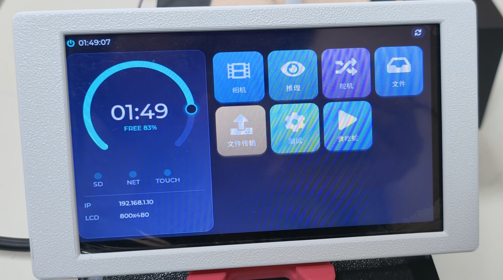

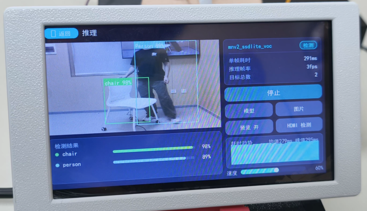

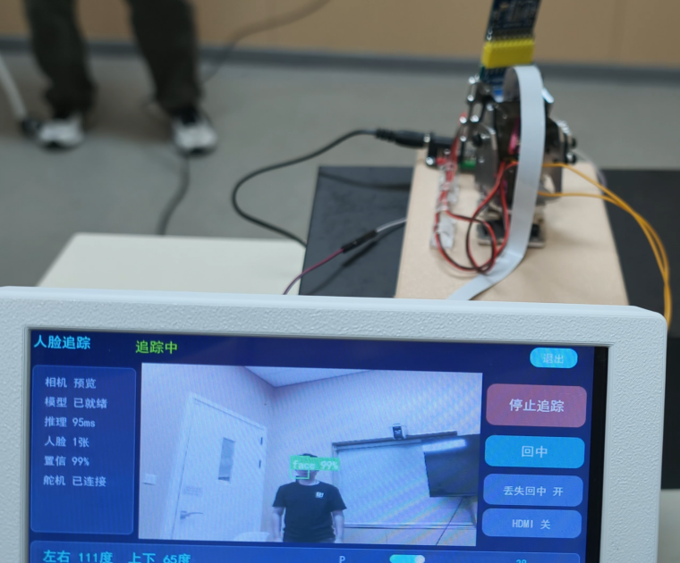

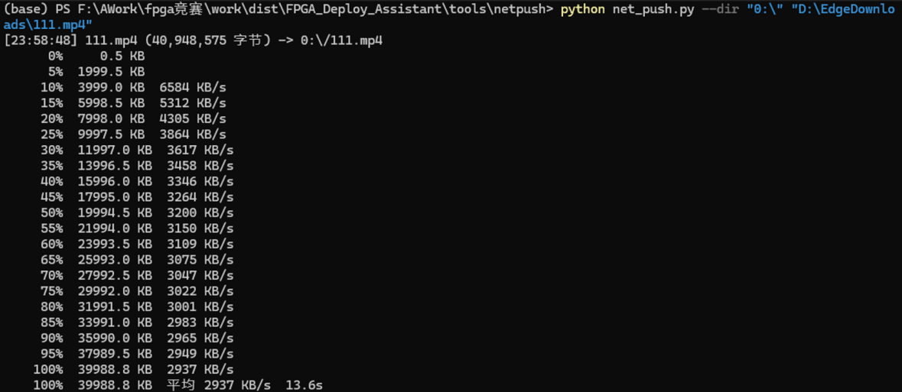

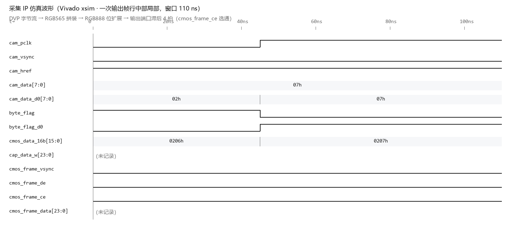

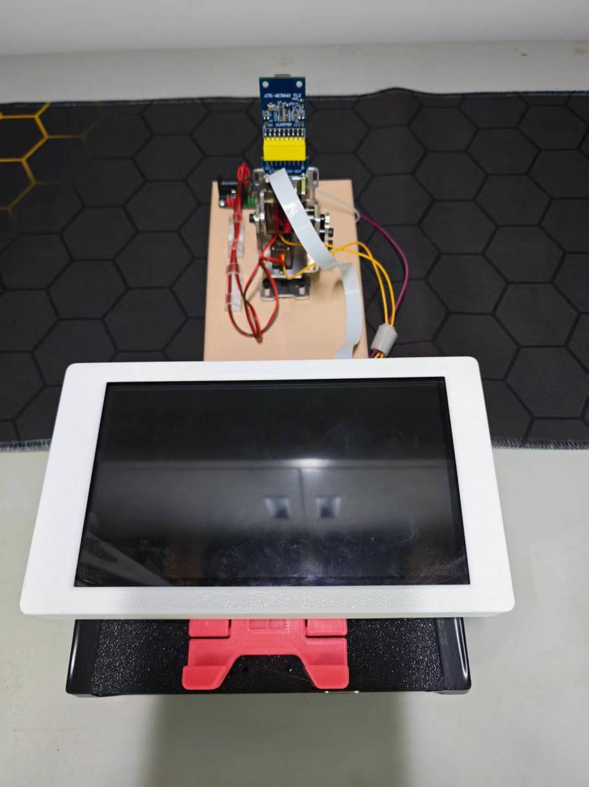

人脸跟踪是两条交付线的汇合：RetinaFace 模型包与跟踪应用均由上位机智能体训练/编译并推送，
检测 10 Hz、控制 20 Hz，速度估计加前馈补偿衔接检测间隔，PID 连续输出平稳跟随。

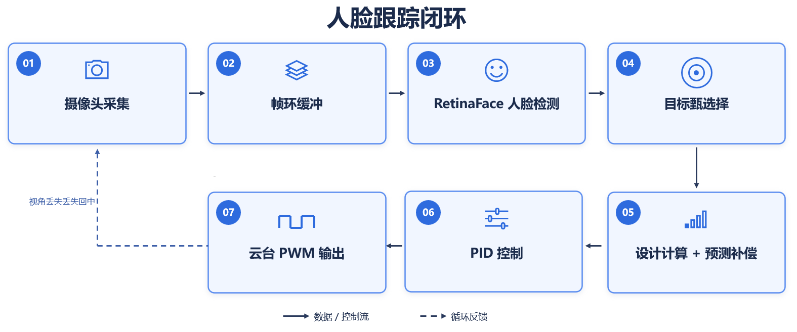

## 参考文献（摘）

[2] Haijoub A, et al. FPGA-Based CNN Acceleration on Zynq-7020 for Embedded Ship Recognition.
    Sensors, 2026, 26(5):1626.  [3] Slimani O, Boudjit K. Acceleration and Energy Optimization
    of CNNs on Zynq-7000 SoC. JESA, 2026, 59(1):157-166.  [10] Deng J, et al. RetinaFace.
    CVPR 2020.  [11] Yang S, et al. WIDER FACE. CVPR 2016.  [12] Tencent ncnn (GitHub).
    [14] lwIP.  [16] RFC 1350 (TFTP). 完整文献表见《技术文档》第五部分。
